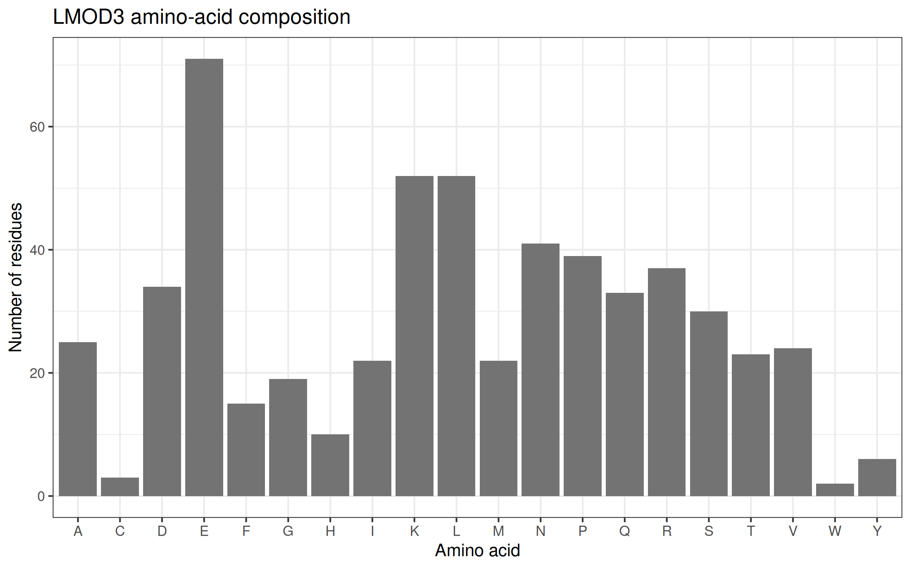

# Muscle-Contractility-LMOD3

## I. Student Information
* **Student Name:** Richelle Gregorio
* **Student ID:** 202400734
* **Laboratory Assignment:** Muscle Contractility and Genetic Variant Analysis
* **Repository Purpose:** This repository contains the R scripts, sequence data, and documentation for analyzing human *LMOD3* and its disease-linked variant.

---

## II. Assigned Gene Details
* **Student Assignment Number:** 40
* **Gene Symbol:** *LMOD3* (*Leiomodin-3*)
* **NCBI Gene ID:** 348932
* **Chromosomal Location:** 3p14.1
* **Assigned RefSeq Transcript:** `NM_198271.5`
* **Retrieved RefSeq Protein:** `NP_938012.2` (560 amino acids)
* **ClinVar Variation ID:** [374498](https://www.ncbi.nlm.nih.gov/clinvar/variation/374498/)[cite: 2]
* **Assigned Variant:** `c.1648C>T` (`p.Leu550Phe` / L550F)
* **Variant Type:** Missense mutation
* **Associated Clinical Condition:** Nemaline Myopathy 10 (NEM10) (OMIM: 616165)

---

## III. Research Question & Objectives

### Research Question
How does the `p.Leu550Phe` mutation in the human *LMOD3* gene affect the Leiomodin-3 protein, and how does this molecular change lead to Nemaline Myopathy 10 (NEM10)?

### Objectives
1. **Automated Retrieval:** Use R to pull the official reference transcript (`NM_198271.5`) and protein sequence (`NP_938012.2`, 560 amino acids) straight from NCBI.
2. **Composition & Mapping:** Calculate the amino acid breakdown of the protein and map the exact location of the variant (`c.1648C>T`, `p.Leu550Phe`) along the sequence.
3. **Clinical Check:** Look up ClinVar (ID `374498`) to verify its medical classification, submitter consensus, and supporting research.
4. **Mechanism & Testing:** Build a clear step-by-step causal chain showing how the mutation disrupts muscle structure, and suggest a lab experiment to test it.

---

## IV. Methods: Step-by-Step R Implementation

### Step 1: Environment Setup and Variables
The script loads the `rentrez` package to download data from NCBI and `ggplot2` to make charts. It sets up the variables of the assignment that is needed (`LMOD3`, `NM_198271.5`, `374498`, `p.Leu550Phe`) and creates local folders (`data`, `results`, `figures`) to store your files.
```R
library(rentrez)
library(ggplot2)

gene_symbol <- "LMOD3"
transcript_accession <- "NM_198271.5"
clinvar_id <- "374498"
variant_protein <- "p.Leu550Phe"

for (x in c("data", "results", "figures")) {
  dir.create(x, showWarnings = FALSE)
}
```
### Step 2: Retrieving Gene Information
The script searches the NCBI Gene database for human LMOD3, extracts the gene ID, description, and chromosome location, and saves them into results/gene_summary.txt.

```R
hits <- entrez_search(
  db = "gene",
  term = paste(gene_symbol, "[Gene Name] AND txid9606[Organism]"),
  retmax = 20
)

gene_id <- NA_character_
for (id in hits$ids) {
  rec <- entrez_summary(db = "gene", id = id)
  if (toupper(rec$name) == toupper(gene_symbol)) {
    gene_id <- id
    gene_info <- rec
    break
  }
}

writeLines(c(
  paste("Gene symbol:", gene_info$name),
  paste("NCBI Gene ID:", gene_id),
  paste("Official name:", gene_info$description),
  paste("Chromosome:", gene_info$chromosome)
), "results/gene_summary.txt")

```
### Step 3: Fetching Protein Sequence
The script downloads the GenBank file for transcript NM_198271.5, pulls the matching protein ID (NP_938012.2), downloads its FASTA sequence, saves it to data/LMOD3_protein.fasta, and records the accession.

```R
gb <- entrez_fetch(db = "nuccore", id = transcript_accession, rettype = "gb", retmode = "text")
pat <- '/protein_id="NP_[0-9]+[.][0-9]+"'
fragment <- regmatches(gb, regexpr(pat, gb))
protein_accession <- gsub('^/protein_id="|"$', "", fragment)

protein_fasta <- entrez_fetch(db = "protein", id = protein_accession, rettype = "fasta", retmode = "text")

fasta_file <- file.path("data", paste0(gene_symbol, "_protein.fasta"))
writeLines(protein_fasta, fasta_file)
writeLines(paste("NP accession:", protein_accession), "results/protein_accession.txt")
```
### Step 4: Amino Acid Composition Analysis
The script reads the FASTA sequence, calculates the total protein length (560 amino acids), counts all 20 standard amino acids, exports the numbers to a CSV file, and generates a composition bar chart saved to the figures folder.
```R
fasta_lines <- readLines(fasta_file)
sequence <- paste(fasta_lines[!grepl("^>", fasta_lines)], collapse = "")
aa <- strsplit(toupper(sequence), "")[[1]]
protein_length <- length(aa)

standard <- strsplit("ACDEFGHIKLMNPQRSTVWY", "")[[1]]
counts <- table(factor(aa, levels = standard))
results_df <- data.frame(Amino_Acid = standard, Count = as.integer(counts))

write.csv(results_df, "results/amino_acid_composition.csv", row.names = FALSE)

fig1 <- ggplot(results_df, aes(Amino_Acid, Count)) +
  geom_col(fill = "grey45") + 
  theme_bw() +
  labs(title = paste(gene_symbol, "amino-acid composition"),
       x = "Amino acid", y = "Number of residues")

ggsave("figures/01_amino_acid_composition.png", fig1, width = 8, height = 5, dpi = 300)
```

### Step 5: Mapping the Variant Position
The script extracts the codon number (550) from p.Leu550Phe, checks that it fits within the protein length, and builds a linear coordinate map showing where the mutation sits on the protein backbone, saving it as figures/02_variant_position.png.
```R
if (nzchar(variant_protein)) {
  matched <- regmatches(variant_protein, regexpr("[0-9]+", variant_protein))
  position <- as.integer(matched)
  
  stopifnot(position >= 1, position <= protein_length)
  
  fig2 <- ggplot() +
    geom_segment(aes(x = 1, xend = protein_length, y = 0, yend = 0), linewidth = 2, color = "grey60") +
    geom_point(aes(x = position, y = 0), size = 4, color = "red") +
    annotate("text", x = position, y = 0.25, label = variant_protein, size = 4, color = "red") +
    xlim(0, protein_length) + ylim(-0.6, 0.6) +
    theme_void() +
    labs(title = paste(gene_symbol, "reference protein position"), x = "Amino-acid position") +
    theme(axis.title.x = element_text())
  
  ggsave("figures/02_variant_position.png", fig2, width = 8, height = 2.5, dpi = 300)
}
```
---

## V. Results 


**Figure 1.** _Amino-Acid Composition Bar Plot_

The bar graph shows the count of each standard amino acid across the 560-residue sequence of LMOD3. Glutamic acid (E), Leucine (L), and Lysine (K) are the most frequent residues in the sequence. While this provides a general chemical baseline for the protein its he simple composition counts still cannot reveal 3D folding, active site boundaries, or how a specific amino acid change affects protein function.


**Figure 2.** Linear Variant Position Map

The recorded result map outlines the 560 amino acid reference backbone of the LMOD3 protein and marks the location of the p.Leu550Phe variant with a point at codon 550. Placing this mutation on the linear coordinate sequence shows that the substitution occurs near the C-terminal end of the protein.

---

## VI. Retrieved ClinVar Records
**URL Visited:** https://www.ncbi.nlm.nih.gov/clinvar/variation/374498/   

**Variant Name:** NM_198271.5(LMOD3):c.1648C>T (p.Leu550Phe).

**NM Transcript:** NM_198271.5   

**HGVS Change:** Nucleotide c.1648C>T, Protein p.Leu550Phe   

**Variant Type:** Missense mutation   

**Associated Condition:** Nemaline Myopathy 10 (NEM10) (OMIM: 616165)   

**Aggregate Classification:** Pathogenic (Backed by clinical groups like TUM Munich and Labcorp/Invitae)   

**Review Status:** 2 stars (Criteria provided, multiple submitters, no conflicts)

**Date Accessed:** October 2026

**Supporting Publication:** PMID: 30291184 (Schatz et al., 2018). 

**Sequence Change Mechanism:** The c.1648C>T change replaces a neutral Leucine with a bulkier Phenylalanine at codon 550.   

**Evaluation Note:** All clinical reports agree that this variant is pathogenic, and predictive tools (like SIFT and PolyPhen-2) flag it as damaging.

---

## VII. Discussion
Analyzing the human LMOD3 gene helps us understand the genetic causes of congenital nemaline myopathy. This gene produces Leiomodin-3 (Lmod3), a specialized protein that helps organize and anchor muscle thin filaments. Using R, we successfully retrieved the reference transcript (NM_198271.5), which corresponds to the protein product (NP_938012.2, spanning 560 amino acids). While calculating amino acid counts gives us a useful chemical baseline, it cannot show how the protein folds in three dimensions or how it functions inside living cells.

The ClinVar database (ID 374498) clearly links the p.Leu550Phe variant to autosomal recessive Nemaline Myopathy 10 (NEM10). As supported by clinical studies such as Schatz et al. (2018) (PMID: 30291184), this mutation replaces a neutral Leucine residue with a bulkier Phenylalanine near the end of the protein. This extra physical bulk disrupts the local structure and hydrophobic packing. Clinically, patients with this mutation experience early muscle weakness, low muscle tone, and the accumulation of abnormal protein aggregates (nemaline rods) in their muscle fibers.

Although clinical databases and predictive computer tools (such as SIFT and PolyPhen-2) strongly indicate that this variant is harmful, they do not directly measure changes in binding strength or protein stability. Further laboratory testing, such as an in vitro actin assembly assay, is necessary to determine exactly how much actin-binding function is lost.   

### Step 7: Structured Molecular Mechanism
**Normal Protein Function in Muscle:** Lmod3 helps build and organize thin filaments at the pointed ends in skeletal and cardiac muscle, maintaining proper muscle structure and length.

**Evidence Breakdown:** Studies (PMID: 30291184) have found p.Leu550Phe in patients with nemaline myopathy. The variant is extremely rare in population databases (0.00002 frequency) and is predicted by computer models to be damaging.

**Proposed Causal chain:** 

**Gene Mutation**(LMOD3 :  _c_.1648_C>T_) &rarr; **Altered Protein Structure**(_p.Leu550Phe_) &rarr; **Molecular Defect** (disrupted hydrophobic packing and impaired actin binding) &rarr; **Cellular pathology**(Impaired thin-filament organization and nemaline rod buildup) &rarr; **Clinical Disease**(Nemaline Myopathy 10/NEM10)

**Proposed Validation Experiment:** An in vitro pyrene-actin polymerization assay. By purifying recombinant wild-type and mutant (L550F) proteins and tracking actin assembly with fluorescence, we can test if the mutant protein has a reduced ability to build actin filaments.

---

## VIII. Questions and Answer
1. **What does your assigned gene encode, and how does this protein contribute to muscle function?**
   * *LMOD3* encodes Leiomodin-3, an actin-nucleating protein at the pointed ends of muscle thin filaments that keeps muscle structure organized.
2. **What was the exact protein accession and length retrieved with R?**
   * Accession **`NP_938012.2`** with a length of **560 amino acids**.
3. **What did the amino-acid composition chart show? What can it NOT tell you?**
   * It showed counts for the 20 standard amino acids. It cannot show 3D folding or how a mutation affects protein interactions.
4. **What is your fixed ClinVar variant, and what is its current classification and evidence strength?**
   * ClinVar ID **374498** (`NM_198271.5:c.1648C>T`, `p.Leu550Phe`), classified as **Pathogenic** with strong multi-submitter evidence.
5. **What is the scientifically supported mechanism linking this variant to muscle function, and what remains uncertain?**
   * It swaps Leucine for Phenylalanine near the C-terminus, causing NEM10 by disrupting thin-filament organization. Exact kinetic shifts in binding remain under study.
6. **What additional experiment would help test the proposed mechanism?**
   * An *in vitro* pyrene-actin polymerization assay to compare assembly rates.
* **Limitations:** Database queries and prediction software provide strong clues and clinical correlations, but they do not directly measure physical 3D structures or protein degradation rates inside living cells.

---

## IX. Reproduction Instructions
To rerun this analysis on a fresh R installation:
1. Open R or RStudio.
2. Install the required packages by running: `install.packages(c("rentrez", "ggplot2"))`.
3. Save the script as `analysis.R` and run it. It will automatically create your folders (`data`, `results`, `figures`), pull data from NCBI, generate composition CSVs, and save your figures. Make sure your exported PNG images are committed and pushed to the `figures/` directory so they render properly in your GitHub README.

---

## X. Database & Reference Links
* **NCBI Gene Record:** [NCBI Gene 348932](https://www.ncbi.nlm.nih.gov/gene/348932)
* **NCBI Protein Record:** [NCBI Protein NP_938012.2](https://www.ncbi.nlm.nih.gov/protein/NP_938012.2)
* **NCBI Nucleotide Record:** [NCBI Nucleotide NM_198271.5](https://www.ncbi.nlm.nih.gov/nuccore/NM_198271.5)
* **NCBI ClinVar Variant 374498:** [ClinVar 374498](https://www.ncbi.nlm.nih.gov/clinvar/variation/374498/)
* **UniProt Consortium:** [UniProt Database](https://www.uniprot.org/)
* **RCSB Protein Data Bank:** [RCSB PDB](https://www.rcsb.org/)
* **AlphaFold Protein Structure Database:** [AlphaFold DB](https://alphafold.ebi.ac.uk/)
* **`rentrez` R Documentation:** [rOpenSci rentrez Docs](https://docs.ropensci.org/rentrez/)
* **Reference (Discovery / PMID 25250574):** [Yuen M, et al. (2014). Leiomodin-3 dysfunction results in thin filament disorganization and nemaline myopathy. *J Clin Invest*, 124(11):4693–4708.](https://pubmed.ncbi.nlm.nih.gov/25250574/)
* **Reference (Milder Phenotype / PMID 30291184):** [Schatz UA, et al. (2018). Evidence of mild founder LMOD3 mutations causing nemaline myopathy 10 in Germany and Austria. *Neurology*, 91(18):e1690-e1694.](https://pubmed.ncbi.nlm.nih.gov/30291184/)
* **Access Date:** October 2026
